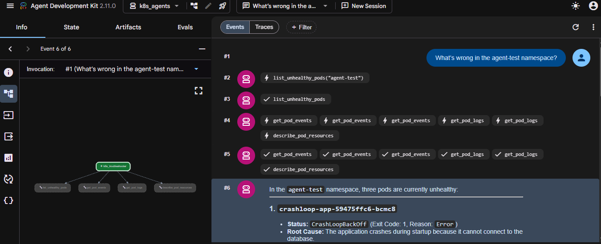

# AI-Powered Kubernetes Troubleshooting Agent (POC)

A proof-of-concept AI agent built with **Google ADK** that investigates unhealthy Kubernetes workloads using **read-only** tools, then reports the root cause, evidence, and a suggested fix.

**Stack:** Python, Google ADK, Gemini (Google AI Studio), Kubernetes Python client, kind, Docker, WSL2

**Status:** Single-agent baseline working (3 of 3 test scenarios diagnosed). Monitoring agent and orchestrator are planned.



---

## 1. Goals

- Apply AI agents to a real SRE/DevOps problem: first-line Kubernetes troubleshooting.
- Keep the agent **safe**: read-only access, it suggests commands but never runs them.
- Build incrementally: one agent with good tools first, then split into multiple agents.

## 2. Architecture

ADK's building blocks (agents, tools, sub-agents, workflow agents) map to this project as follows:


**Current (implemented):**

```
User question
     │
k8s_troubleshooter (LLM agent)
     ├── list_unhealthy_pods
     ├── get_pod_events
     ├── get_pod_logs
     └── describe_pod_resources
```

**Planned:**

```
Orchestrator (root agent)
 └── Incident workflow (Sequential)
      ├── Parallel gather
      │    ├── K8s Troubleshooter
      │    ├── Monitoring Agent (metrics-server / Prometheus)
      │    └── Logs Agent
      ├── RCA Summarizer (LLM, no tools)
      └── Remediation Agent (proposes fixes, human approval)
```

## 3. Project structure

```
agent-development/
├── k8s_agents/
│   ├── __init__.py        # from . import agent
│   ├── agent.py           # agent definition
│   ├── k8s_tools.py       # read-only Kubernetes tools
│   └── .env               # GOOGLE_API_KEY (never commit)
├── manifests/             # broken apps + RBAC for repeatable tests
├── docs/
│   ├── sample-output.md
│   └── images/
├── .gitignore
└── README.md
```

## 4. Prerequisites

- Windows with **WSL2** (Ubuntu) and **Docker Desktop** (WSL integration enabled for your distro)
- `kubectl` and `kind`
- Python 3.10+
- A free API key from [Google AI Studio](https://aistudio.google.com)

Keep the project in the Linux filesystem (`~/...`), not under `/mnt/c/...`. Docker, kind, and Python run much faster there.

## 5. Setup

### 5.1 Create the kind cluster

```bash
kind create cluster
kubectl get nodes        # should show Ready
```

### 5.2 Deploy the broken test apps

Namespace and three deliberately failing workloads, one per scenario. Save these under `manifests/`.

```bash
kubectl create namespace agent-test
```

**Scenario 1: ImagePullBackOff** (`manifests/imagepull.yaml`)

```yaml
apiVersion: apps/v1
kind: Deployment
metadata:
  name: imagepull-app
  namespace: agent-test
spec:
  replicas: 1
  selector:
    matchLabels: {app: imagepull-app}
  template:
    metadata:
      labels: {app: imagepull-app}
    spec:
      containers:
      - name: app
        image: nginx:this-tag-does-not-exist
```

**Scenario 2: OOMKilled** (`manifests/oom.yaml`)

```yaml
apiVersion: apps/v1
kind: Deployment
metadata:
  name: oom-app
  namespace: agent-test
spec:
  replicas: 1
  selector:
    matchLabels: {app: oom-app}
  template:
    metadata:
      labels: {app: oom-app}
    spec:
      containers:
      - name: app
        image: polinux/stress
        command: ["stress"]
        args: ["--vm", "1", "--vm-bytes", "200M", "--vm-hang", "1"]
        resources:
          limits:
            memory: 50Mi
```

**Scenario 3: CrashLoopBackOff** (`manifests/crashloop.yaml`)

An app that prints a startup message, logs `ERROR: Database connection failed`, and exits with code 1. Any container that exits non-zero on startup works.

Apply and verify:

```bash
kubectl apply -f manifests/
kubectl get pods -n agent-test
```

Expected statuses: `CrashLoopBackOff`, `ErrImagePull` (then `ImagePullBackOff`), and `CrashLoopBackOff` for the OOM pod.

Confirm the OOM pod's last termination reason:

```bash
kubectl describe pod -n agent-test -l app=oom-app | grep -A5 "Last State"
```

You should see `Reason: OOMKilled` and `Exit Code: 137` (SIGKILL, 128 + 9).

### 5.3 Create a read-only identity (least privilege)

```bash
kubectl create serviceaccount agent-reader -n agent-test
kubectl create clusterrole agent-readonly \
  --verb=get,list,watch \
  --resource=pods,pods/log,events,deployments.apps,nodes
kubectl create clusterrolebinding agent-readonly \
  --clusterrole=agent-readonly \
  --serviceaccount=agent-test:agent-reader
```

Locally the agent uses your kubeconfig. This ServiceAccount is what it should use when later deployed in-cluster. Export these to `manifests/rbac.yaml` so a rebuild restores them.

### 5.4 Install ADK and create the agent

```bash
cd ~/agent-development
python3 -m venv .venv && source .venv/bin/activate
pip install google-adk kubernetes
adk create k8s_agents
```

Choices made in the `adk create` prompts:

| Prompt | Choice | Why |
|---|---|---|
| Model | `gemini-3.8-flash` | Flash tier is fast, cheap, and good at tool calling |
| Backend | Google AI | Only needs an API key, no GCP project or billing |

The API key is stored in `k8s_agents/.env`:

```
GOOGLE_GENAI_USE_VERTEXAI=0
GOOGLE_API_KEY=your-key-here
```

Keep secrets out of git:

```bash
printf ".env\n.venv/\n__pycache__/\n" > .gitignore
```

### 5.5 Tools: `k8s_agents/k8s_tools.py`

```python
from kubernetes import client, config

try:
    config.load_incluster_config()
except config.ConfigException:
    config.load_kube_config()

v1 = client.CoreV1Api()
MAX_LOG_CHARS = 3000


def list_unhealthy_pods(namespace: str) -> dict:
    """List pods in a namespace that are unhealthy, with the reason for each.

    Args:
        namespace: Kubernetes namespace to inspect.
    """
    result = []
    for p in v1.list_namespaced_pod(namespace).items:
        for cs in (p.status.container_statuses or []):
            reason, detail = None, None
            if cs.state.waiting:
                reason = cs.state.waiting.reason
                detail = cs.state.waiting.message
            elif cs.state.terminated and cs.state.terminated.exit_code != 0:
                reason = cs.state.terminated.reason
            elif not cs.ready and p.status.phase == "Running":
                reason = "NotReady"
            if reason:
                last = cs.last_state.terminated if cs.last_state else None
                result.append({
                    "pod": p.metadata.name,
                    "container": cs.name,
                    "reason": reason,
                    "message": (detail or "")[:300],
                    "restarts": cs.restart_count,
                    "last_termination_reason": last.reason if last else None,
                    "last_exit_code": last.exit_code if last else None,
                })
    return {"namespace": namespace, "unhealthy": result}


def get_pod_events(namespace: str, pod: str) -> dict:
    """Get the most recent events for a pod.

    Args:
        namespace: Kubernetes namespace.
        pod: Pod name.
    """
    events = v1.list_namespaced_event(
        namespace, field_selector=f"involvedObject.name={pod}").items
    events.sort(key=lambda e: e.last_timestamp or e.event_time or e.metadata.creation_timestamp)
    return {"pod": pod,
            "events": [f"{e.type} {e.reason}: {e.message}"[:300] for e in events[-10:]]}


def get_pod_logs(namespace: str, pod: str, previous: bool = False) -> dict:
    """Get the last lines of a pod's logs. Use previous=True for a crashed container.

    Args:
        namespace: Kubernetes namespace.
        pod: Pod name.
        previous: If True, fetch logs from the previously terminated container.
    """
    try:
        logs = v1.read_namespaced_pod_log(
            pod, namespace, tail_lines=50, previous=previous)
        return {"pod": pod, "previous": previous, "logs": logs[-MAX_LOG_CHARS:]}
    except client.ApiException as e:
        return {"pod": pod, "error": f"{e.status}: {e.reason}"}


def describe_pod_resources(namespace: str, pod: str) -> dict:
    """Get image, resource requests/limits, and node for a pod.

    Args:
        namespace: Kubernetes namespace.
        pod: Pod name.
    """
    p = v1.read_namespaced_pod(pod, namespace)
    return {
        "node": p.spec.node_name,
        "containers": [{
            "name": c.name,
            "image": c.image,
            "limits": c.resources.limits,
            "requests": c.resources.requests,
        } for c in p.spec.containers],
    }
```

Design notes:

- **Read-only:** no function modifies the cluster.
- **Trimmed output:** logs, events, and messages are truncated so the model is not flooded with tokens.
- **Reads container state, not just pod phase:** a `CrashLoopBackOff` pod can report phase `Running`, and the real cause of an OOM crash lives in `last_state.terminated`.
- **Docstrings matter:** ADK uses them as the tool descriptions the model sees.

### 5.6 Agent: `k8s_agents/agent.py`

```python
from google.adk.agents import Agent
from .k8s_tools import (list_unhealthy_pods, get_pod_events,
                        get_pod_logs, describe_pod_resources)

root_agent = Agent(
    name="k8s_troubleshooter",
    model="gemini-3.8-flash",
    description="Diagnoses Kubernetes workload problems.",
    instruction="""You are a Kubernetes SRE. Investigate step by step:
1. Call list_unhealthy_pods for the namespace.
2. For each unhealthy pod, call get_pod_events.
3. For crashing pods, call get_pod_logs with previous=True.
4. For OOMKilled or scheduling issues, call describe_pod_resources.
Report per pod: root cause, evidence from tool output, and a suggested fix.
Never claim something the tool output does not show. You are read-only:
suggest kubectl commands but never claim to have run them.""",
    tools=[list_unhealthy_pods, get_pod_events,
           get_pod_logs, describe_pod_resources],
)
```

`k8s_agents/__init__.py` must contain:

```python
from . import agent
```

### 5.7 Run

From the folder that **contains** `k8s_agents/`:

```bash
source .venv/bin/activate
adk web
```

Open the printed URL (usually `http://localhost:8000`), select `k8s_agents`, and ask:

> What's wrong in the agent-test namespace?

## 6. Results

The agent diagnosed all three scenarios. Full verbatim output: [docs/sample-output.md](docs/sample-output.md).

| Scenario | Root cause found | Evidence used |
|---|---|---|
| `crashloop-app` | App fails at startup (database connection error in logs) | Previous-container logs, BackOff events |
| `imagepull-app` | Image tag does not exist | Pull-failure events |
| `oom-app` | Exceeded 50Mi memory limit | `OOMKilled`, exit 137, resource limits |

**3 of 3 scenarios diagnosed correctly** (single run, manual review).

Tool-call trajectory: `list_unhealthy_pods` first, then events, logs, and resource lookups in parallel, then the final answer (see the screenshot at the top).

## 7. Troubleshooting log (issues hit during the build)

### Control plane restarting repeatedly (leader election lost)

- **Symptom:** `kube-controller-manager` and `kube-scheduler` showed 200+ restarts.
- **Evidence:** controller-manager logs showed lease renewal timing out against the API server (`context deadline exceeded`) followed by `leaderelection lost`.
- **Likely cause:** slow API server / etcd, probably disk I/O pressure on WSL2 with a low memory cap (about 3.7GiB). This was not confirmed from the logs alone.
- **Mitigation:** raised WSL2 resources in `C:\Users\<you>\.wslconfig`:

  ```ini
  [wsl2]
  memory=6GB
  processors=4
  ```

  then ran `wsl --shutdown`. The cluster was recreated and the manifests reapplied.

### `kubectl` and `docker` not found after `wsl --shutdown`

- **Cause:** both came from Docker Desktop's WSL integration, which detaches when WSL restarts.
- **Fix:** start Docker Desktop, then enable **Settings → Resources → WSL Integration** for the Ubuntu distro, then open a fresh WSL terminal. If the kind container is stopped: `docker start kind-control-plane`.
- **Hardening:** install `kubectl` directly so it no longer depends on Docker Desktop.

### Other tips

- Scale down the crash-looping app between tests to reduce API churn: `kubectl scale deploy crashloop-app -n agent-test --replicas=0`
- Browse WSL files from Windows at `\\wsl$\Ubuntu\home\<user>`, or run `explorer.exe .` in the project folder.

## 8. Safety design

- Read-only tools only; no create, patch, delete, or exec.
- Least-privilege RBAC ServiceAccount (`get/list/watch`).
- The agent suggests `kubectl` commands but never executes them.
- Tool output is truncated to avoid token blowups.
- Logs and events are treated as untrusted input (they could contain prompt-injection text).

## 9. Roadmap

- [ ] Monitoring agent (metrics-server, then Prometheus tools)
- [ ] Orchestrator with Parallel gather and Sequential RCA summary
- [ ] Remediation agent with human approval (Slack or CLI)
- [ ] ADK evals using the three scenarios as test cases
- [ ] Deploy in-cluster using the read-only ServiceAccount
- [ ] Alertmanager webhook trigger and Slack notifications
- [ ] Tracing for the agents (OpenTelemetry, Langfuse, or Cloud Trace)

## 10. Limitations

- POC only: tested on one local kind cluster with three synthetic failures.
- Results come from a single run; LLM output varies between runs.
- No automated evals yet.
- Root causes are only as reliable as the logs and events the agent reads.
