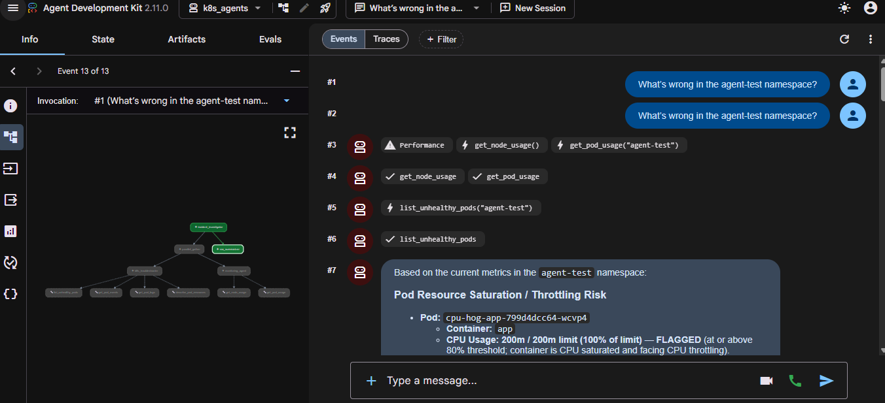
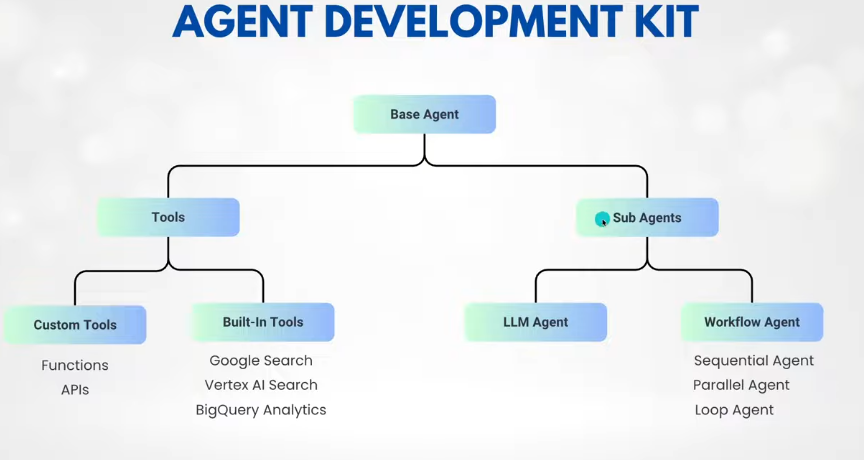

# AI-Powered Kubernetes Troubleshooting Agent (POC)

A multi-agent system built with **Google ADK** that investigates unhealthy Kubernetes workloads, summarizes the root cause, and proposes fixes that a **human must approve** before anything changes in the cluster.

**Stack:** Python, Google ADK, Gemini (Google AI Studio), Kubernetes Python client, metrics-server, kind, Docker, WSL2

**Status:** Working POC on a local kind cluster. Diagnosis, monitoring, remediation proposals, and the approval CLI are tested. The in-cluster deployment and alert webhook are written but **not yet tested** (see [Roadmap](#9-roadmap)).



---

## 1. What it does

Ask it "What's wrong in the agent-test namespace?" and it:

1. Runs a **troubleshooter** and a **monitoring** agent in parallel.
2. Merges their findings into one incident report (**RCA summarizer**).
3. Queues fix proposals for the clear cases (**remediation agent**), without executing anything.
4. Waits for a human to review and apply a proposal with `approve.py`.

## 2. Architecture

```
User question (or alert webhook)
        │
incident_investigator (SequentialAgent)
 ├── parallel_gather (ParallelAgent)
 │     ├── k8s_troubleshooter  → pod status, events, logs, resource specs
 │     └── monitoring_agent    → node/pod CPU and memory via metrics-server
 ├── rca_summarizer (LLM, no tools) → incident report
 └── remediation_agent → queues proposals (cannot change the cluster)
                              │
                     human: python approve.py list / approve <id>
                              │
                     validated, confirmed, audit-logged cluster change
```

How ADK's building blocks map to this project:



### Agents and models

Each agent has its own model setting in `k8s_agents/models.py`, so a single model's daily quota doesn't stop the whole pipeline. Override any of them with environment variables (`TROUBLESHOOTER_MODEL`, `MONITORING_MODEL`, `SUMMARIZER_MODEL`, `REMEDIATION_MODEL`, `AGENT_MODEL`).

| Agent | Role | Tools | Default model |
|---|---|---|---|
| `k8s_troubleshooter` | Diagnoses failing pods | `list_unhealthy_pods`, `get_pod_events`, `get_pod_logs`, `describe_pod_resources` | `gemini-3-flash-preview` |
| `monitoring_agent` | Finds resource saturation | `get_node_usage`, `get_pod_usage` | `gemini-3.1-flash-lite` |
| `rca_summarizer` | Merges findings into one report | none | `gemini-3.5-flash-lite` |
| `remediation_agent` | Queues fix proposals | `propose_remediation` | `gemini-3-flash-preview` |

Model availability and free-tier quotas vary by key and change over time. Preview models can change or disappear, so check which models your key can use before relying on the defaults.

## 3. Project structure

```
├── k8s_agents/
│   ├── agent.py               # root SequentialAgent + summarizer
│   ├── troubleshooter.py      # troubleshooter agent
│   ├── monitoring.py          # monitoring agent
│   ├── remediation.py         # remediation agent
│   ├── k8s_tools.py           # read-only Kubernetes tools
│   ├── monitoring_tools.py    # metrics-server tools
│   ├── remediation_tools.py   # proposal-only queue + validation
│   ├── models.py              # per-agent model settings
│   └── .env                   # GOOGLE_API_KEY (never commit)
├── approve.py                 # human approval CLI
├── webhook.py                 # Alertmanager-style webhook (not yet tested)
├── Dockerfile, requirements.txt, .dockerignore
├── manifests/                 # broken test apps, agent Deployment
├── docs/                      # sample outputs, run evidence, screenshots
└── README.md
```

## 4. Prerequisites

- Windows with **WSL2** (Ubuntu) and **Docker Desktop** with WSL integration enabled for your distro
- `kubectl` and `kind`
- Python 3.10+
- An API key from [Google AI Studio](https://aistudio.google.com)

Keep the project in the Linux filesystem (`~/...`), not `/mnt/c/...`.

## 5. Setup

### 5.1 Cluster and test workloads

```bash
kind create cluster
kubectl create namespace agent-test
```

Apply the four scenario manifests in `manifests/` one by one (check the exact file names in your copy):

| Scenario | Workload | What goes wrong |
|---|---|---|
| CrashLoopBackOff | `crashloop-app` | Prints an error and exits with code 1 |
| ImagePullBackOff | `imagepull-app` | Image tag `nginx:this-tag-does-not-exist` |
| OOMKilled | `oom-app` | Allocates about 200M under a 50Mi limit |
| CPU saturation | `cpu-hog-app` | Runs, but sits at its 200m CPU limit |

Don't apply the whole folder with `-f manifests/`, because it also contains the agent's own Deployment.

### 5.2 metrics-server (for the monitoring agent)

```bash
kubectl apply -f https://github.com/kubernetes-sigs/metrics-server/releases/latest/download/components.yaml
kubectl patch -n kube-system deployment metrics-server --type=json \
  -p '[{"op":"add","path":"/spec/template/spec/containers/0/args/-","value":"--kubelet-insecure-tls"}]'
kubectl top nodes
```

`--kubelet-insecure-tls` is needed on kind because kubelet certificates are self-signed. Metrics only exist for **running** containers, so crashing pods have none, which is why `cpu-hog-app` exists.

### 5.3 Read-only identity (for in-cluster use)

```bash
kubectl create serviceaccount agent-reader -n agent-test
kubectl create clusterrole agent-readonly \
  --verb=get,list,watch \
  --resource=pods,pods/log,events,deployments.apps,nodes
kubectl create clusterrolebinding agent-readonly \
  --clusterrole=agent-readonly \
  --serviceaccount=agent-test:agent-reader
kubectl create clusterrole agent-metrics-readonly \
  --verb=get,list --resource=pods.metrics.k8s.io,nodes.metrics.k8s.io
kubectl create clusterrolebinding agent-metrics-readonly \
  --clusterrole=agent-metrics-readonly \
  --serviceaccount=agent-test:agent-reader
```

Locally the agent uses your kubeconfig. This ServiceAccount is what the in-cluster pod uses.

### 5.4 Python environment

```bash
python3 -m venv .venv && source .venv/bin/activate
pip install google-adk kubernetes fastapi uvicorn
```

Put your key in `k8s_agents/.env` (see `.env.example`):

```
GOOGLE_GENAI_USE_VERTEXAI=0
GOOGLE_API_KEY=your-key-here
```

### 5.5 Run

From the repo root:

```bash
adk web
```

Select `k8s_agents`, start a **New Session**, and ask: *What's wrong in the agent-test namespace?*

## 6. Reviewing and approving fixes

The remediation agent only writes proposals to `remediation/pending.json`. A human decides:

```bash
python approve.py list
python approve.py approve <id>     # shows the action, asks you to type 'yes'
python approve.py reject <id>
```

Run `approve.py` as a single command on its own line. If you paste several lines at once, the extra lines can be read as the answer to the confirmation prompt, which cancels the approval (the cancel is the safe outcome).

## 7. Results

| Run | Scenarios | Result |
|---|---|---|
| Single agent | crashloop, imagepull, oom | 3 of 3 root causes correct ([sample](docs/sample-output.md)) |
| Multi-agent | + cpu-hog saturation | 4 of 4 correct ([sample](docs/sample-output-multiagent.md)) |
| Remediation | imagepull, oom | Fixes proposed, approved, and applied; recovery verified ([evidence](docs/remediation-run.md)) |

All results are single runs reviewed by hand. There is no automated eval suite yet.

### Lessons learned

- **A plausible fix isn't necessarily a working one.** The first OOM proposal doubled the limit (50Mi to 100Mi). The app allocates about 200M, and the 100Mi pod was OOMKilled again (verified in the cluster).
- **Agents can only reason from what the tools show.** The tool output hid the container's command and args. After adding them and telling the agents to size from evidence, the next proposal was 250Mi, and the pod ran with 0 restarts at 200Mi usage (re-checked after 18 minutes).
- **Human approval caught the weak proposal** on a test workload, and the audit log recorded every decision.
- **The agents correctly declined to guess** for the crashloop (an application or dependency error) and CPU saturation cases.
- **Metrics only exist for running pods**, so crash scenarios need log and event tools, and saturation scenarios need monitoring tools.

## 8. Safety design

- The agent's tools are read-only. `propose_remediation` writes to a local queue file and cannot touch the cluster.
- Proposals are validated against allowlists (namespaces, actions, value formats) when queued **and again** at approval. Verified: a proposal in `kube-system` is rejected, and re-approving an applied proposal is refused.
- A human must type `yes`. Every decision is appended to `remediation/audit.jsonl`.
- Tool output is truncated to limit token use, and logs and events are treated as untrusted input (they could contain prompt-injection text).
- Least-privilege RBAC identity for in-cluster use (`get/list/watch` only).
- The `.dockerignore` keeps `.env` out of the image, and the in-cluster key comes from a Kubernetes Secret.

## 9. Roadmap

- [x] Troubleshooter agent with read-only tools
- [x] Monitoring agent (metrics-server)
- [x] Parallel gather and sequential RCA summarizer
- [x] Remediation agent with human approval, validation, and audit log
- [x] Per-agent model settings
- [ ] In-cluster deployment (Dockerfile and manifest written, not yet built or tested)
- [ ] Alert webhook and Slack reporting (`webhook.py` written, not yet tested; Alertmanager is not installed, so testing would use simulated payloads)
- [ ] Shared approval queue so proposals made in-cluster can be approved from outside
- [ ] ADK evals (an early eval set exists but is out of date)
- [ ] Post-fix verification (re-check the workload after approval)
- [ ] Tracing for the agents (OpenTelemetry, Langfuse, or Cloud Trace)

## 10. Troubleshooting log

**Control plane restarting repeatedly (leader election lost).** `kube-controller-manager` and `kube-scheduler` showed 200+ restarts, and logs showed lease renewals timing out against the API server. This is probably disk and memory pressure on WSL2 (not confirmed). Raising resources in `C:\Users\<you>\.wslconfig` helped, and the cluster was recreated from the manifests:

```ini
[wsl2]
memory=6GB
processors=4
```

**`kubectl` and `docker` missing after `wsl --shutdown`.** Both came from Docker Desktop's WSL integration. Fix: start Docker Desktop, enable **Settings → Resources → WSL Integration** for your distro, and open a fresh terminal.

**Free-tier quota errors (429).** The Gemini free tier allowed 20 requests per day per model on this key, and one multi-agent investigation makes many model calls. Fixes: give each agent its own model, check the limits for your key, and run one investigation at a time. Temporary 503 `UNAVAILABLE` errors are Google-side load and clear on their own.

**Stalled rollout after reapplying a manifest.** Reapplying a broken manifest over a fixed deployment starts a new bad pod, while Kubernetes keeps the healthy old one until the new one is Ready. Delete the deployment and apply the manifest again to reset a scenario.

## 11. Limitations

- POC only: one local kind cluster and four synthetic failures.
- Single manual runs. LLM output varies between runs.
- Free-tier quotas allow only a few full investigations a day.
- Root causes are only as reliable as the logs, events, and metrics the agents read.
- The in-cluster deployment, alert webhook, and shared approval queue are not finished.
